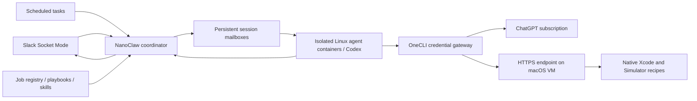
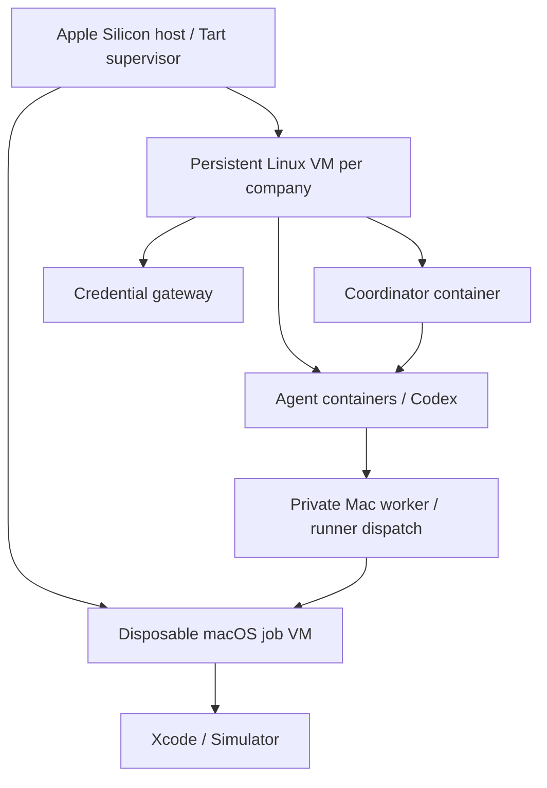

# NanoClaw job harness

The product target is a **portable company agent**: one independent deployment
per company, with company-owned identity, Slack/GitHub connections, subscription
authentication, and configurable workflows. See [the product contract](PRODUCT.md)
for the ParkTab onboarding target, PR review integration, optional Tart workers,
and acceptance criteria. The capabilities below describe the current starter.

**Start with [the company setup checklist](ONBOARDING.md).**
`pnpm run company:init` creates one commented `company.local.yaml` for identities,
named channels/users, model profiles, integration choices, and enabled workflows.
`company:check` reports missing or unsupported choices; `company:build` generates
the deployment inputs. This is the preferred path for a new company.

This is a local NanoClaw fork with Slack, Codex, and OneCLI installed from
upstream's feature payloads. `upstream.json` records the revisions. It has not
been connected to a Slack workspace, ChatGPT account, Linux VM, or iOS project.

Verified locally on October 28, 2026: coordinator and Codex-enabled agent images
built for Linux arm64; five harness tests passed on the host and in the
coordinator image; 265 focused upstream Slack/provider/gateway tests passed;
the required Codex provider contract verifier passed, including the runtime
typecheck and conformance tests. The MCP initialization/tool-discovery probe and
a native macOS `simctl list devices available --json` probe also passed. This
does not establish live Slack delivery, subscription refresh, gateway-to-worker
connectivity, Linux amd64 compatibility, or an app test inside a macOS VM.

The job model is declarative: triggers select a job, a playbook describes the
flow, reusable skills supply domain procedures, and a sink determines where
the result goes. Company instructions, resource mappings and credentials are
supplied independently for each deployment.



## What works in this starter

- Company YAML centralizes names, Slack access, inference profiles, business
  context, optional integration inventory, worker endpoints, and workflow choices.
  Its resolver generates the low-level registry, templates, a branded Slack
  manifest, and environment templates. Unsupported active connectors, workflows,
  and account routing are rejected instead of ignored.
- `jobs.example.json` defines incident mentions, a daily report, and explicit
  `ios-check` messages. `compile.ts` validates the registry and generates real
  NanoClaw plugin templates. It runs NanoClaw's own parser over every output.
- `provision.ts` stamps the templates, chooses Codex, creates an owner and job
  memberships, wires approved channels, and creates report destinations. New
  recurring tasks start paused. It uses the daemon's administrative `ncl` API.
- Mention jobs use native sticky threads. Pattern jobs require the pattern on
  each message; they do not implicitly capture follow-ups. Use separate channels
  or distinct patterns; overlapping regexes can deliberately fan out to jobs.
- Every job has a separate group/workspace; upstream provides per-thread
  sessions, restart behavior, approvals and delivery. Selected custom skills
  are copied per job. NanoClaw's standard runtime skills remain available.
- `mac-worker.mjs` runs natively in macOS with a configured command list. Its
  MCP client runs in the Linux agent. The worker authenticates requests, limits
  output and duration, rejects unknown recipes/extra arguments, and runs one
  recipe at a time. It accepts no agent-supplied shell commands or file paths.

This is a small declarative layer over NanoClaw, not a durable multi-step DAG
engine. Playbooks guide agent steps; schedules and conversation persistence are
upstream behavior. There is no webhook ingress, separate remote Codex runtime,
automatic checkout sync to the Mac, or screenshot attachment pipeline yet.

## Subscription and team identities

The registry accepts an optional `inference` object at the top level and on each
job: `model` is a Codex model identifier and `effort` is its reasoning-effort
setting. Job fields override installation defaults individually; omitted fields
retain the configured default. Provisioning passes the resolved values to the
group's native model/effort configuration. Use identifiers and effort values
supported by the authenticated runtime; validation checks syntax, not entitlement
or model compatibility. Changing these settings after provisioning follows the
same explicit update procedure as other registry changes.

This implements per-job selection. Selecting models for individual steps and
routing to multiple subscriptions are target capabilities described in
[the product contract](PRODUCT.md#models-subscriptions-and-execution-profiles).
They are not implemented by this registry's `inference` fields.

Use the unmodified Codex runtime with ChatGPT sign-in. There is no API-key
fallback in this setup. Included subscription usage still has limits; purchased
credits and API authentication can incur extra cost. Keep credit purchases or
automatic top-ups disabled if a fixed subscription bill is required. VM hosting
and third-party service costs are separate.

OpenAI documents ChatGPT authentication for Codex and an advanced private
automation flow, while recommending API keys for general automation:
[authentication](https://learn.chatgpt.com/docs/auth),
[private automation](https://learn.chatgpt.com/docs/auth/ci-cd-auth),
[usage and credits](https://learn.chatgpt.com/docs/pricing).

**One Pro account is not a pool of team seats.** This starter's gateway has one
Codex identity per installation; `executionIdentity` is an audit label, not a
per-user credential selector or proof of subscription entitlement. Slack member
access and model-account entitlement are different things. The example enables
only its owner. For the initial Pro pilot, use your own Slack identity. Before
opening it to the team, choose appropriately licensed workspace identities or
separate installations/logins for their account holders. Per-user model auth
routing is not implemented. Do not copy your daily desktop auth cache into this
service; use a fresh dedicated login through NanoClaw's provider setup.

The pinned gateway explicitly says unattended ChatGPT refresh is unverified:
[upstream note](../.claude/skills/add-onecli/references/chatgpt-oauth-refresh.md).
An expired/revoked login may require reconnection. Do not treat this as an
unattended production SLA. Quota/authentication errors must be surfaced;
do not add paid-provider failover to hide them.

## Local verification

From the repository root, with Node 22+ and the pinned pnpm available:

```sh
pnpm install --frozen-lockfile
pnpm run build
pnpm exec tsc -p harness/tsconfig.json
node --import tsx harness/compile.ts
node --import tsx --test harness/config.test.ts
node --test harness/mac-worker.test.mjs
docker compose -f harness/compose.yaml config --quiet
```

`harness/install-features.ts` was already run. It is an upstream feature
materializer, not a startup step; running it on a refreshed checkout can fetch
new channel-branch code and change dependencies. Review changes and update
`upstream.json` when deliberately upgrading. Container builds use the lockfile
and the already-materialized source.

## Linux VM rollout

1. Place this prepared checkout at the company YAML's `deployment.root`
   (default `/opt/company-agent`) on the dedicated VM. Install
   Docker, Node and pnpm, then install frozen dependencies and build the host.
   The checkout must remain available: NanoClaw bind-mounts runner source into
   agent containers. Keep coordinator and host checkout at the same revision.
2. Run `pnpm run company:init`, fill in `harness/company.local.yaml`, then run
   `pnpm run company:check` and `pnpm run company:build`. If already prepared
   locally, transfer the private YAML to the VM and rebuild its generated files.
   See [the checklist](ONBOARDING.md) for each setting and capability status.
3. On first installation, copy `harness/generated/runtime.env.example` to `.env`,
   mode 0600. Import `harness/generated/slack-app-manifest.json`
   at Slack's app management page, install it,
   and create an app-level token with `connections:write`. Store the `xoxb-` bot
   token and `xapp-` app token in `.env`. Invite the bot to the configured channels.
4. On the VM, run the installed gateway setup, followed by provider login:

   ```sh
   node --import tsx .claude/skills/add-onecli/scripts/setup.ts
   node --import tsx setup/index.ts --step provider-auth codex
   ```

   Choose ChatGPT device pairing/browser sign-in, not API-key login. Complete
   sign-in in your browser. Use the gateway version pinned in the feature's
   `versions.json`. The gateway and vault run separately from the coordinator.
   Check its generated `.env` values. `ONECLI_URL` must be reachable from the
   coordinator container, not the coordinator's localhost. Bind the local
   gateway's management API only to the appropriate private interface and allow
   the coordinator to reach it. Agent egress is governed by upstream's gateway
   network rules. Do not expose gateway management ports publicly.

5. Build the agent image **on the target VM at the final checkout path**, then
   build and start the coordinator:

   ```sh
   ./container/build.sh
   mkdir -p data groups logs store
   docker compose --env-file harness/generated/deployment.env -f harness/compose.yaml build
   docker compose --env-file harness/generated/deployment.env -f harness/compose.yaml up -d
   docker compose --env-file harness/generated/deployment.env -f harness/compose.yaml logs --tail 80 coordinator
   pnpm run harness:provision harness/company.local.yaml
   ```

   The generated deployment settings supply `NANOCLAW_ROOT`; the runtime env
   template supplies `NANOCLAW_TEMPLATES_DIR`. Keep existing `.env` values in sync
   if the root changes. The same path must exist inside and outside the coordinator. Runtime
   state is bind-mounted with matching absolute paths so sibling agent containers
   see the exact files the coordinator writes. The Docker socket makes the
   coordinator privileged relative to its VM; agents never receive that socket.

6. Inspect `node dist/cli/client.js tasks list --json`. Resume only the intended
   task with `node dist/cli/client.js tasks resume --id <series-id> --group
<group-id>`. Send one mention in an enabled workflow's channel from an authorized Slack account and
   verify a thread reply, then verify that an unlisted member cannot invoke it.
   Confirm gateway reauthentication and quota behavior before broad rollout.

`provision.ts` records a receipt in `data/harness-provision.json`. Repeating the
same config is a no-op. A changed config stops instead of silently leaving old
permissions behind. For updates, inspect `ncl groups create --template <job>`
for a restamp preview, apply the reviewed template with `--yes`, update/remove
members and wirings through `ncl`, and restart the affected group. This version
does not automatically reconcile removals or retry partially completed deployment
changes across a changed registry. Back up data/groups and the gateway vault.

Legacy `harness/jobs.local.json` is still accepted by `harness:compile` and
`harness:provision`. It uses the original manual environment/manifest setup;
company YAML is the preferred source for new deployments.

## Shared Mac host and independent company deployments

The [host integration](HOST-API.md) connects this independently released company
service to `company-vm-host` through HTTP API v1. Configure a worker
with `hostProfile` to request company-scoped VM leases from its shared allocator.
Agent jobs and CI share worker quotas; each company retains its own Linux VM,
code release, state and credentials. The standalone native worker remains
available when no host profile is supplied.

## macOS VM worker

The coordinator needs a Linux environment with Docker. That can be a cloud Linux
VM or a persistent Tart Linux VM on an Apple Silicon Mac. In the latter layout,
Tart runs on the physical Mac host and starts sibling Linux and macOS guests:



The coordinator and agents use the Docker daemon in the Linux guest. These are
ordinary containers inside a VM; no nested VM is needed for Linux agents. Keep
company state and authentication in the persistent installation, not in disposable
macOS clones. A separate host supervisor owns Tart lifecycle and capacity.
The existing native worker is only the tool endpoint inside a prepared macOS
environment; it does not yet dispatch jobs to the host supervisor.

Running the coordinator in a macOS guest would still require a way to run its
Linux agent containers. Prefer the Linux guest for this stack, with macOS guests
reserved for native Apple tools. Companies using a cloud Linux VM can attach
the same remote Mac worker without moving their coordinator to Apple hardware.
Tart supports both guest types on Apple Silicon; see its
[repository](https://github.com/openai/tart) and [guest images](https://tart.run/quick-start/).
This topology is a deployment recommendation, not a tested Tart installation.

The Linux agent remains the planner. Native Apple tools run in a separate macOS
VM on Apple hardware, with Xcode and the needed Simulator runtime installed.
A Linux container inside a Mac still cannot run iOS Simulator. This split also
avoids requiring nested Docker virtualization inside the macOS guest.
[Apple's Xcode requirements](https://developer.apple.com/xcode/system-requirements)
and [macOS VM guide](https://developer.apple.com/documentation/virtualization/running-macos-in-a-virtual-machine-on-apple-silicon).

1. Copy `mac-worker.mjs` and `mac-worker.example.json` to the VM. Rename the latter
   `mac-worker.local.json`. Set the checkout, workspace, scheme and installed
   simulator name. Commands run against the checkout already present on the VM;
   sync and select the revision explicitly before testing.
2. Create a random bearer token in a 0600 file on the VM. Run the worker with
   Node 22+:

   ```sh
   MAC_WORKER_TOKEN_FILE=/absolute/private/worker-token \
     node /absolute/path/mac-worker.mjs /absolute/path/mac-worker.local.json
   ```

3. Keep its loopback listener private. Expose it through a trusted HTTPS reverse
   proxy or private-network HTTPS tunnel with a valid certificate. Point the job's
   `macos.url` at that origin. Use a service manager in the macOS guest for restart.
4. In the OneCLI vault, register the worker token for that exact HTTPS hostname,
   replacing the outgoing `Authorization: Bearer placeholder` header. Attach that
   secret only to the iOS job's gateway agent. The client sends a placeholder and
   uses Node's environment proxy support; the real token stays in the gateway.
   Validate this custom-host injection through the chosen gateway before enabling
   the job. No live gateway/macOS network integration was tested in this starter.
5. Enable the iOS job, provision it, and send `ios-check` in its channel. First
   verify the `simulators` recipe, then `ios-tests`. A 409 response means the VM
   is busy; jobs must be explicitly retried. Worker output is capped at 1 MiB,
   so configure concise test output or a summary script for a large test suite.

Run the recipe under a dedicated VM user. A recipe's argv is operator-controlled
and can invoke a checked-in script when a flow needs multiple native steps.
This is deliberately a narrow tool worker, not an arbitrary remote shell and
not a second shared model login. Per-job capabilities are enforced by which
worker endpoint/token is granted; for different trust levels, use separate
worker instances with different recipe sets and credentials.
